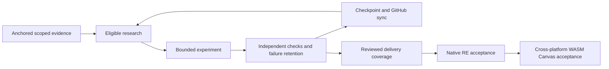

# Evidence-driven delivery graph and continuing Canvas loop

The user authorized extending the existing continuous loop on 2026-10-10 through both declared GitHub milestones: independently verified native RE, followed by the supported cross-platform WASM Canvas contract. The existing heartbeat remains active at ten-minute cadence; no extra scheduler, paid service or delegated agent is created. Machine/app availability and account limits still bound execution.

## Graph and selection

`tools/re/agent.py graph` validates delivery dependencies from the GitHub roadmap, rejecting cycles, duplicate dependencies and unknown nodes. [Research policy](../../research/loop/workgraph.json) adds separately scoped research tasks; [the checkpoint graph](../../research/loop/workgraph-report.json) has30 nodes and47 typed edges. Acceptance prerequisites constrain delivery completion; research-assists edges permit useful investigation before those prerequisites are fully accepted.

Evidence prerequisites use external checkpoint hashes, complete sealed artifact/source verification, successful execution and supporting verdict. Corrupted evidence is quarantined; missing anchors keep work in evidence-required state. Blocked tracks carry the existing changed-prerequisite records. Completed research requires explicitly listed accepted runs matching the task's allowed experiment IDs; it is skipped on future selection without closing its delivery issue. Ready tasks sort by declared priority, downstream delivery impact and stable ID. The planner exposes the same research frontier and next task.

Delivery acceptance requires an explicit contract-reviewed attestation, anchored supporting runs, sealed coverage artifact and accepted dependencies. GitHub issue closure or a collection of passing owned controls does not automatically satisfy that gate. Historical issue closure remains GitHub state; the new conservative acceptance attestations are initially empty, requiring coverage reconciliation before claiming completion. Both milestone completion flags remain false. At this checkpoint the owned generation task is complete and portable browser execution is the next independent ready task. Native correlated capture and typed private continuation execution retain their changed-method prerequisites.

## Graph-selected generation experiment and regression repair

The graph selected an owned reconstruction commit policy. Six policy rejection/acceptance cases and two content-lifetime cases consume actual audited native CPU mutable/separate IOSurface frames. Current results commit; superseded, duplicate, canceled, prior-session reset and wrong-content results reject. Frozen first-frame snapshots commit; delayed first reads reject for reused mutable storage and commit for separate original storage. Admission requires strict increasing uint64 generation and bounded immutable bytes. Reset advances an epoch; successful commit consumes its ticket. Failed commits preserve the last accepted frame and pending current ticket.

This deliberately uses immutable expected bytes at admission and compares submitted content at commit. It does not assume generation tags alone freeze shared memory; the native delayed read supplies a concrete contrary control. These are reconstruction policy rules, not recovered Canvas session/generation fields, locking, synchronization or GPU fences. They do not establish concurrent atomicity or private native completion behavior.

Two campaigns pass128 controls each over16 native executions per campaign. Five measured frame phases compare102,400 CPU image bytes across both campaigns, including row padding; this corpus does not claim comparison of unused IOSurface allocation tail. Native ID/reference/endpoint/peer-exit and scoped100ms lookup checks remain required. The repaired R1 failure/timeout corpus passes12 cases and12 repeat comparisons with no helper failures; no physical reclamation claim follows.

The first generation campaign fails compilation because shared GPU helper evolution added folder/count parameters but CPU reuse and failure callers retained the old signatures. That failed seal is retained. Passing explicit parameters repairs both helpers; the generation repeat and R1 control validate the repair rather than merely editing source. [Evidence and four manifest anchors](../../research/evidence/graph-generation-2026-10-10.json) retain the failure and all three accepted runs. All243 tests pass, including graph cycle/quarantine/block/completion faults and commit rejection/state preservation controls. No Xcode windows opened or user processes altered.

## Continuing loop

Each wake reads the graph and checkpoint, verifies relevant identities/anchors, reviews blockers and the live milestone backlog, and either implements the next missing probe or executes a discriminating changed experiment. Failures cause diagnosis or switching to independent work. After verified milestone1 completion, report the transition and continue milestone2 implementation; pause after both declared contracts are verified, or explicit user request. If every task needs external change/input, record exact blockers and perform cheap prerequisite checks rather than repeating expensive failures. This is continuous authorized progress, not a promise to bypass external constraints or silently claim unrestricted SwiftUI equivalence.
