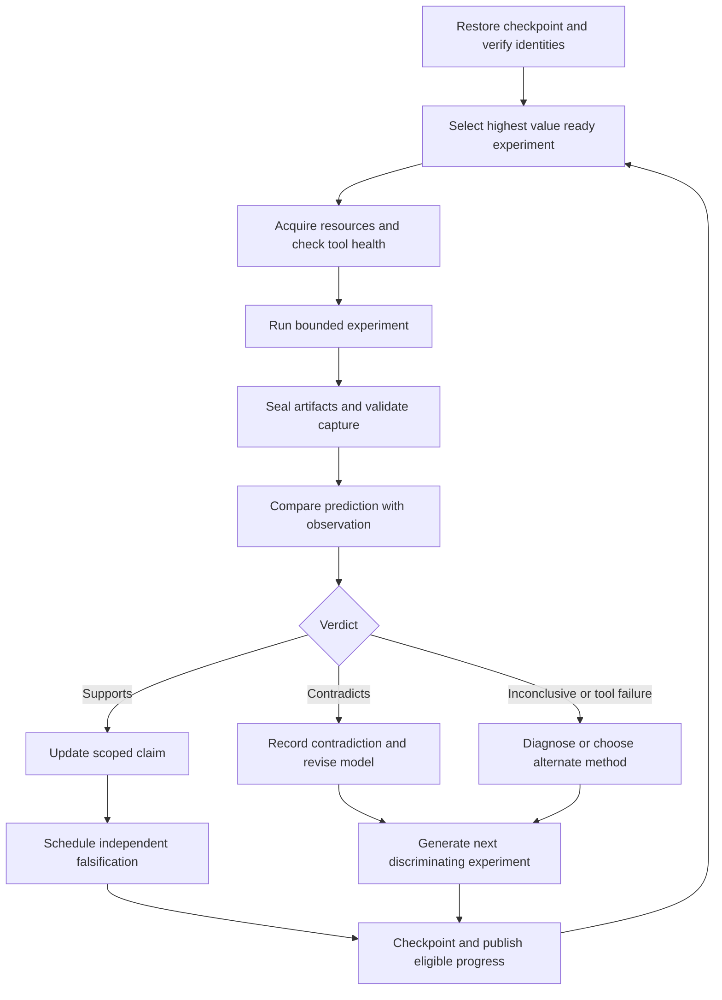

# Agentic reverse engineering loop

Status: bounded local controller and MCP server implemented; live Xcode preview protocol recovery remains the next campaign. See the [toolkit guide](toolkit.md) for commands and measured validation. Scope: recover Xcode preview semantics, validate a portable boundary, and build only the parts supported by evidence. Initial target: Xcode 26.6 (17F113), macOS 26.5.1 (25F80), arm64. This design extends the [initial findings](2026-10-08-initial-findings.md), not the speculative protocol in the original roadmap.

## Outcome and boundaries

The loop should produce a versioned protocol model, replayable local fixtures, a native reference harness, and a measured compatibility report. It should make progress while the operator is away, recover from ordinary tool failures, and leave enough evidence for another agent to resume without trusting conversational memory.

Success proceeds through explicit milestones:

| Milestone | Acceptance evidence |
| --- | --- |
| M0: reproducible inventory | Target hashes/UUIDs, tool versions, successful isolated metadata and serialization probes |
| M1: one complete native preview | Owned minimal project; launch-to-first-output trace, correlated request/reply, decoded payload, captured image |
| M2: protocol semantics | Controlled variations establish fields, discriminants, optionality, failure behavior, sequencing and output ownership |
| M3: native adapter | Decode and validate real fixtures; reproduce a selected output through an owned harness, without inventing missing fields |
| M4: portable contract | Explicit supported subset; mappings for native-only features; validated schema and conformance fixtures |
| M5: portable vertical slice | Owned Swift compatibility source → WASM → software image; compare with a native reference under declared tolerances |

M0 now has automated inventory, isolated runtime probes, immutable run packaging and evidence verification. M1–M5 are not achieved. Protocol recovery and SwiftUI reimplementation are separate workstreams. A successful Apple binary probe never proves that SwiftUI can run on WASM.

Routine inspection, owned probe execution, local source edits, and progress synchronization are within the current task. Keep experiments confined to owned test projects and dedicated helper/preview processes. Do not change system protections, re-sign installed Apple applications, or modify the Xcode installation as a recovery tactic. If a required operation falls outside existing authority or tool permissions, checkpoint the precise blocker and continue independent work.

## Controller and workers

Use one controller as the sole writer of queue state, claim status, and Git history. Workers receive bounded experiment specifications and return artifacts; they cannot declare overall milestones complete. These are roles, not a requirement for separate agents: one agent can execute them serially. Enable parallel workers only when the operator explicitly requests delegation.

| Role | Input | Output |
| --- | --- | --- |
| Controller | Queue, claims, health, budget | Selected experiment, lease, next action, checkpoint |
| Static investigator | Fingerprinted image and symbol query | Disassembly, bounded decompilation, candidate fields/call edges |
| Runtime investigator | Owned harness and versioned probe | Loaded image identities, metadata, synthetic probe result |
| Trace investigator | Owned preview session and capture plan | Correlated lifecycle events, envelopes, output and instrumentation diagnostics |
| Falsifier | Claim and supporting evidence | Counterexperiment, contradictions, narrower claim or corroboration |
| Adapter implementer | Accepted semantics and fixtures | Decoder/adapter changes, fixture validation and differential results |
| Recorder | Run manifest and verdict | Sanitized evidence summary, updated claims, progress commit |

Optional parallel work must use separate worktrees and per-run Ghidra projects. A live debugger session, simulator device, Ghidra program database, and Git index each have one owner. Two workers must never mutate the same analysis project or instrument the same process simultaneously.



## Durable state and provenance

Commit reviewed design, queue definitions, claim summaries, sanitized fixtures and code. Keep executable images, full dumps, decompiled implementations, detailed traces, and mutable controller state local. Do not rely on `.gitignore` as the only publication check.

Design layout (the current executor uses `output/` for adapter artifacts and one exclusive controller lock rather than separate worker leases):

```
research/loop/experiments.json          # Reviewed experiment definitions
research/claims/<claim-id>.json        # Reviewed claim and evidence references
research/runs/<run-id>/manifest.json   # Local immutable run provenance
research/runs/<run-id>/events.jsonl    # Local append-only controller journal
research/runs/<run-id>/artifacts/      # Local stdout, stderr, captures, fixtures
research/state/checkpoint.json        # Local resumable queue state
research/state/leases.json            # Local resource ownership
research/evidence/                    # Reviewed publishable summaries
schemas/re-experiment.schema.json     # Experiment definition contract
```

Every run receives a unique ID before execution. Its manifest records experiment revision/hash, parent run if retrying, UTC times, monotonic duration, repository commit and dirty diff hash, source fixture hash, relevant environment variables with secret values excluded, exact executable/arguments, working directory, tool versions, target image SHA-256/UUID/architecture, loaded image identities, exit status or signal, timeout/cancellation reason, artifact hashes, and validation results. System-cache images use runtime UUID plus OS/cache identity where a standalone file hash is unavailable; never fabricate a file hash.

The controller writes manifests atomically and seals a run only after child processes terminate and artifact hashes are finalized. A sealed run is immutable. Retrying creates a new run with a parent reference. An interrupted run remains `incomplete`; recovery checks its recorded process identity and leases, collects available artifacts, and marks it interrupted before scheduling a fresh run. PID alone is insufficient because it can be reused.

Keep environment snapshots separate from run results and reference them by hash. Version changes invalidate readiness for ABI-dependent probes and acceptance of affected claims. Re-baseline affected experiments; do not overwrite old results or compare ASLR addresses across launches. Store image-relative symbol addresses and record the load slide when using runtime pointers.

Claims have an ID, narrowly worded assertion, version/architecture/fixture scope, status, evidence references, counterevidence, reproduction recipe, missing checks, and consumers. Status is one of `candidate`, `supported`, `corroborated`, `contradicted`, or `superseded`. Preserve superseded history.

Examples:

- Supported: this exact `UVPropertyList` implementation round-trips the owned synthetic dictionary as a Foundation-decodable binary plist.
- Unsupported extension: every preview IPC message consists only of binary-plist bytes.
- Supported: a particular SDK exports a render-related Swift enum case.
- Unsupported extension: the case name is the wire discriminant, or its presence proves that the current session used that rendering path.

Disassembly and decompilation of the same binary are related views of one source, not independent corroboration. Stronger corroboration combines static interpretation, an executed probe, and a controlled real-session observation with matching target identities.

## Selection and experiment contract

Start with [the seeded queue](../../research/loop/experiments.json). Each experiment states a falsifiable hypothesis, expected observations, a distinguishing counterexperiment, prerequisites, resource locks, timeout and artifact limits, required artifacts, acceptance criteria, and follow-ups for support, contradiction and failure. The [schema](../../schemas/re-experiment.schema.json) defines the machine-readable shape. Acceptance criteria are reviewed assertions for a validator to implement, not arbitrary model-generated code to execute.

Select only experiments whose dependencies are completed, required capabilities are healthy, and resources are available. Rank ready experiments by:

```
priority = (3 × expected_information_gain + 2 × downstream_unlocks
            + uncertainty_reduction) / estimated_cost
```

Scores are planning estimates, not probabilities. Break ties by choosing the smallest experiment with the clearest disproof condition. Prefer recovering one real request/reply over indexing another large framework without a question. Reserve roughly one fifth of experiment effort for counterexamples and reproduction; failures can justify adjusting this allocation.

Do not treat absence as evidence unless the capture was validated to observe the event. A debugger breakpoint that did not resolve cannot disprove that its function executed.

Keep execution outcome separate from scientific verdict:

- Execution: `success`, `failed`, `timed_out`, `cancelled`, `interrupted`.
- Verdict: `supports`, `contradicts`, `inconclusive`, `not_evaluated`.

Exit zero means the process completed, not that the hypothesis is true. A crash may contradict a robustness claim or may only expose a broken harness. Classify it explicitly.

## Tool adapters and preflight

Adapters expose `health`, `prepare`, `run`, `collect`, `validate`, and `cleanup`. They return typed statuses and artifact references. The model chooses experiments and interprets bounded summaries; the executor owns process control, filesystem limits and resource leases. Use argument arrays, explicit working directories and allowlisted adapter operations. Captured source, strings, pseudocode and logs are untrusted evidence, never executable instructions.

| Adapter | Existing starting point | Additional requirement |
| --- | --- | --- |
| Inventory | `tools/re/collect.py` | Per-run output; reject stale or incomplete identity data |
| Runtime metadata | `runtime_dump.m` | Separate host/OS processes, loaded UUID verification |
| Serialization | `plist_probe.m` | Fixture corpus, negative cases and machine-readable assertions |
| Native key probe | `message_keys.swift` | Fingerprint gate before linking/calling version-specific ABI |
| Disassembly | `disassemble.py` | Query-driven selection, image-relative addresses and bounded output |
| Ghidra | `DumpPreviewFunctions.java` | Health check, isolated project, explicit partial-analysis status |
| Owned trace | LLDB Python and Frida adapters implemented | Real canvas lifecycle and request/reply correlation still needed |
| Decoder/reference | Loss-preserving plist decoder, native ImageRenderer, PNG differential checker | Real attachment model and replay remain open |
| Evidence candidate | `agent.py report` | Verifies sealed run hashes; human/agent reviews explicit files before Git publication |

The runtime script accepts an isolated `RE_OUT`; controller workers use frozen source copies and unique run directories. `summarize.py` remains the manual initial-findings index. The controller report is generated from sealed runs and keeps failed/inconclusive results separate. Selection currently uses reviewed integer priorities and dependencies; automatic claim promotion, model-generated counterexperiments and publication remain controller-agent decisions, not unattended code.

Preflight validates the selected Xcode and OS identities, disk budget, tool availability, process ownership, and compilation of a trivial owned probe. For GhidraVibe MCP, first check `vibe_health` and the program engine; follow the installed project's health guidance. An installed app is not evidence of a healthy engine. Direct headless Ghidra is a separate adapter with its own startup and import checks. Use the locally established working JDK configuration rather than repeatedly launching a known incompatible JVM.

## Native preview tracing campaign

Begin with an owned macOS project to reduce simulator variables. Keep its source, configuration, native artifact identities, and fixture revision under control. First verify an uninstrumented `#Preview` produces a visible reference image. Then identify the actual preview processes and loaded images for that session; never assume a stable PID or executable name is sufficient.

Instrument progressively:

1. Observe process launch, loaded images, exit and native output with no method interception.
2. Resolve the selected loader and transport symbols against the current images; validate breakpoints resolve and fire.
3. Capture events at the narrowest useful serialization/send/receive boundary. Preserve method/function ABI, thread context and original behavior. Do not cast an unknown Swift signature to a C function pointer.
4. Capture owned message values, reply correlation, direction and stream identity where observable. XPC attachments, audit information, listener endpoints, IOSurface handles and layer context IDs are typed resources, not ordinary JSON or portable bytes.
5. Exercise one controlled source or interaction change, then capture incremental update and cleanup.
6. Repeat without instrumentation to detect observer effects such as debugger-induced timing changes.

The trace adapter records monotonic timestamp, process/thread identity, image UUID and symbol offset, local event sequence, observed stream/request identifiers, direction, original payload hash, decoded representation, attachment descriptors and capture completeness. Missing values are marked unknown. Correlate by observed IDs; timestamp proximity alone is a tentative edge.

Do not infer ownership from a handle's integer value. Determine who creates, retains, transfers and releases the resource. Replay only through an owned compatible harness after modeling these lifetimes. A sanitized fixture needs both original provenance and a transformation manifest; its hash will differ from the original capture.

Use this controlled matrix after the baseline works:

| Variable | Initial variations | Question |
| --- | --- | --- |
| Content | `Text`, then simple stack | Registry and update payload differences |
| Update | Literal edit, structural edit, no edit | Incremental versus full work |
| Viewport | Size, scale, appearance individually | Field ownership and coordinate semantics |
| Output | Static snapshot versus live host if selectable | Bitmap versus hosted resource path |
| Failure | Owned compile error, missing fixture, cancellation | Error and cancellation envelopes |
| Lifecycle | First load, warm update, restart | Handshake, caching and identity reuse |
| Platform | macOS first, one pinned iOS simulator later | Shared semantics versus platform extensions |

Pin available versions actually installed; do not label a matrix row supported merely because a runtime is listed.

## Evaluation and falsification

Validators check artifact existence and schema, process completion, target identity, capture coverage, decoding fidelity and the experiment's specific assertions. The reviewer compares the pre-registered prediction with observations before updating a claim. If results are ambiguous, schedule the smallest experiment that distinguishes alternatives.

For bitmap work, validate dimensions, stride, data extent, bits per component/pixel, byte order, alpha interpretation, color space and scale independently. Preserve original bytes before conversion. Separate protocol/metadata equality from rendered-image similarity. Image comparisons must declare normalization, fonts, rendering environment and tolerance; perceptual similarity cannot prove wire compatibility.

Promote semantics into an adapter only after a real fixture and at least one counterexample or controlled variation support them. Separate stages of validation:

1. Decode without losing unknown fields or attachments.
2. Encode/decode owned fixtures and compare normalized semantics.
3. Compare a native reference with the owned harness.
4. Test portability only within the declared supported subset.

Never silently turn a platform-only resource into an invented bitmap. Unsupported behavior is explicit and measurable.

## Bounded execution and recovery

Initial defaults are configurable engineering budgets: one experiment at a time, a 45-minute session, at most eight experiments, 1 GiB new artifacts per session, and two GiB Ghidra heap for targeted images. Existing raw caches are not copied into each run; use hashed references. If a capture needs a larger budget, checkpoint a concrete revised experiment before proceeding.

Use separate startup, execution and idle timeouts. Defaults: 30 seconds for ordinary tool preflight, 180 seconds for cold Ghidra startup, 120 seconds for targeted auto-analysis, 60 seconds per selected decompilation, and 180 seconds for the first owned preview output. These are starting limits, not measured service guarantees. An outer watchdog bounds the whole process tree because internal analysis limits are not wall-clock guarantees. Emit concise progress at least every 60 seconds during active sessions.

| Failure | Recovery | Stop condition |
| --- | --- | --- |
| Dead Ghidra engine | Record health failure; attempt one bounded restart, then use headless/static fallback | No healthy alternative for the required experiment |
| Analysis timeout | Preserve partial project; decompile selected functions or narrow the image | Required function still unavailable after one narrower attempt |
| Runtime crash | Preserve diagnostics; isolate framework variants; reduce to minimal owned probe | Same signature repeats without a new hypothesis |
| Unresolved breakpoint | Recheck image UUID, architecture, mangling, load timing and slide | Capture coverage cannot be established |
| Preview does not launch | Confirm uninstrumented harness first; inspect its diagnostics | Cannot distinguish harness failure from instrumentation failure |
| Compiler/linker ABI mismatch | Re-resolve exports and signatures for the fingerprinted target | Signature cannot be established; do not guess |
| Permission/tool rejection | Record exact action and reason; continue unaffected experiments | Required dependent action needs operator intervention |
| Disk/session budget | Seal current run, release resources and checkpoint | No further runs until budget is renewed |
| No new information | Change method once; revise question | Three equivalent inconclusive runs without new evidence |

A retry needs a changed condition or a new diagnostic purpose; do not repeat an expensive failed run unchanged. Tool failures do not count as experimental contradictions. Stop and report an actionable checkpoint when all ready experiments are blocked, a session budget is reached, or a milestone is accepted. Do not create a recurring job or automatically renew budgets merely because this design describes unattended work.

On cleanup, stop only process trees launched by the run, detach owned debugger sessions, release locks, preserve crash evidence, and restore only the settings the experiment itself changed. Do not terminate existing user Xcode or simulator sessions.

## GitHub synchronization and resumption

Continue the established `master`/`development` workflow. `development` receives coherent experiment/tool improvements and reviewed findings. `master` receives verified milestones by fast-forward where possible; preserve unrelated changes and never force-push as recovery. One controller performs Git mutations. Publish once per meaningful checkpoint, not after each log line.

Before publishing, inspect the explicit file list and staged diff. Exclude Apple binaries, full pseudocode, raw logs, personal project material, tokens, absolute user paths and unsanitized captures. A synthetic fixture can be committed with its provenance. Mark hypotheses as hypotheses in both findings and progress. Do not let a publisher copy all artifacts from a run automatically.

If GitHub is unavailable, retain local commits and mark sync pending; scientific work can continue. Successful synchronization requires remote branch confirmation, not merely a locally updated remote-tracking name. Do not move `master` while milestone acceptance is unresolved.

The checkpoint must answer: what was attempted; which claims changed; what failed and why; what processes/locks remain; where sealed artifacts live; what is committed/pushed; and the exact next ready experiment. Resume by reading checkpoint and event journal, validating run identities and resource ownership, then re-evaluating queue readiness. Do not replay the last mutation blindly.

## Reference control logic

```text
restore_checkpoint()
reconcile_interrupted_runs_and_leases()
verify_environment_identity()

while within_session_budget():
    experiment = select_ready_experiment()
    if experiment is None:
        checkpoint_and_report_blockers()
        break
    run = create_run_and_acquire_resources(experiment)
    try:
        health = preflight(experiment)
        if not health.ok:
            outcome = record_tool_failure(health)
        else:
            outcome = execute_with_outer_watchdog(experiment)
        artifacts = collect_and_hash(outcome)
        validation = validate(experiment, artifacts)
        verdict = evaluate_prediction(experiment, outcome, validation)
        seal_run(run, outcome, validation, verdict)
        update_scoped_claims_and_counterevidence(run)
        enqueue_discriminating_followups(run)
    finally:
        cleanup_owned_processes_and_release_resources(run)
        checkpoint_atomically()
    if publishable_checkpoint_exists():
        review_explicit_diff_and_sync_eligible_changes()
    if milestone_accepted():
        report_evidence_and_remaining_limits()
        break
```

## Implementation sequence

1. **Make runs immutable:** parameterize current tools with run directories, introduce manifests/journal/leases, and separate manual claims from measured output. Verify interruption/resumption and environment-change handling.
2. **Implement bounded controller:** schema validation, queue selection, watchdog, artifact hashes, verdict separation, checkpoint and publication checks. Use deterministic owned fake adapters to test timeout, crash, stale output and restart cases before running private frameworks unattended.
3. **Build the owned native harness and trace adapter:** validate uninstrumented output, capture one complete preview, preserve original evidence and produce a reviewed fixture.
4. **Add falsification and replay:** controlled matrix, negative fixtures, semantic decoder, resource lifecycle model, and differential checks.
5. **Only then implement the portable contract and vertical slice:** choose the supported subset from observed requirements; measure correctness and explicitly unsupported features.

Use [the operator prompt](agentic-loop-prompt.md) for supervised execution. Recovery, process-tree cleanup, strict validation, MCP framing and evidence-integrity checks have automated tests. The implemented executor runs reviewed adapters; the controlling agent supplies hypothesis revision and counterexperiments. This document describes the complete campaign, including later stages the executor does not yet implement.
