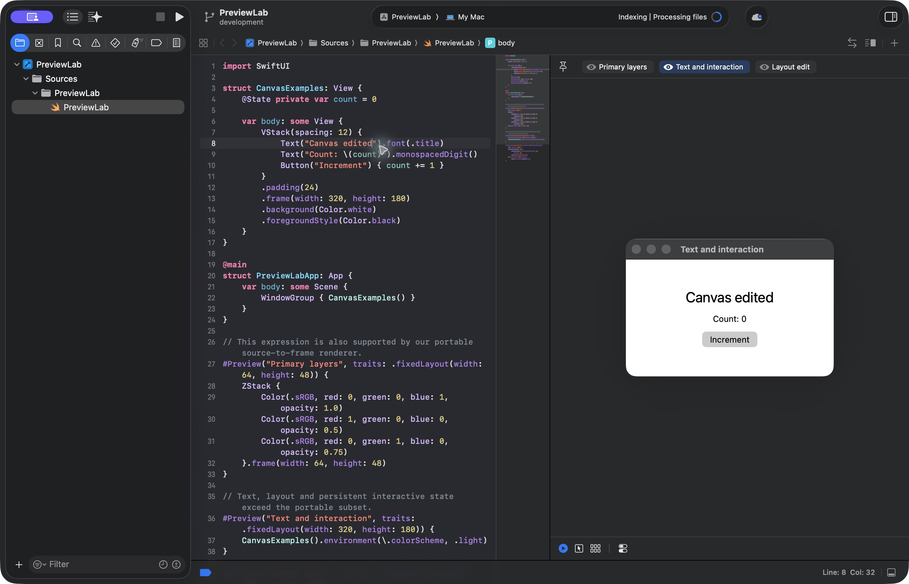
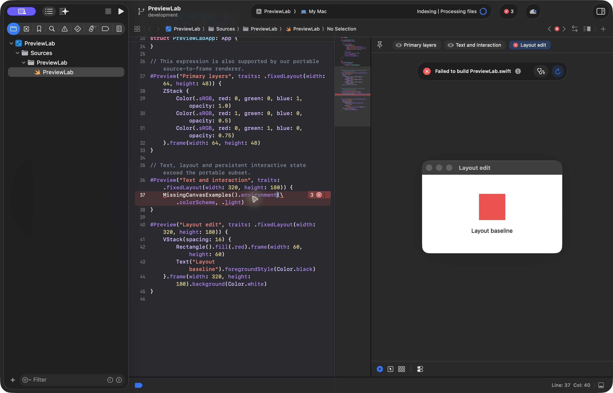

# Editing SwiftUI in Xcode Canvas versus the reconstruction

On 2026-10-10, an owned copy of `examples/CanvasExamples` was opened in Xcode.
All source edits and Canvas interactions used the Xcode UI. The user’s existing
Wawona project was preserved. The examples provide primary-color composition,
text with interactive state, and horizontal/vertical layout.

## Observed behavior

| Controlled action | Native Canvas observation | Portable reconstruction |
|---|---|---|
| Resume Canvas | Built the app and rendered the selected named preview | Compiles a bounded expression to C, LLVM IR and WASM, then renders a frame |
| Green opacity 0.25 → 0.75 | Purple interior changed to green without reopening project | Same expression rendered at 64×48, with distinct verified pixel allocation and PNG |
| Title baseline → edited | Visible preview title text changed | `Text` rejected as unsupported |
| Increment button | Count 1 observed once after Count 0; subsequent automated click attempts remained at 0. Repeatable input delivery is unproven | No interactive state support |
| Title refresh after interaction | Edited title rendered with Count 0 | State migration/retention not implemented; this single observed reset does not establish a general native rule |
| HStack → VStack | Rectangle moved from beside label to above it | Layout and Rectangle not implemented |
| MissingCanvasExamples symbol | Error annotations and “Failed to build PreviewLab.swift”; previous layout frame remained visible | Unsupported Text returned exit 1 and left `current.json` byte-identical |
| Restore valid baseline in editor | Error cleared; horizontal layout and original purple color returned | Baseline immutable output remains retained |

The layout baseline originally inherited a light foreground against its explicit
white background, hiding the label in the current appearance. Adding an explicit
black foreground made the label visible. The reusable example includes that fix.

## Pixel comparison limits

The CUA capture bytes are **JPEG**, with an embedded display ICC profile. They are
stored using `.jpg`, without re-encoding. These are UI screenshots, not the native
Canvas frame callback or native exported PNG.

An interior 40×40 screenshot region `[2220, 950, 2260, 990]`, excluding title chrome
and rounded corners, was transformed through the embedded profile to sRGB before
sampling. The resulting medians were `(123, 80, 127)` for baseline and
`(87, 197, 77)` after the opacity edit. Portable PNG interior RGBA values were
`(96, 64, 95, 255)` and `(32, 191, 32, 255)`. Both paths visibly changed toward
green, but these captures do **not** establish pixel equivalence. Lossy encoding,
display conversion and the native rendering/export path remain confounders.

The portable renderer remains supported by its separately sealed native callback
comparison experiment. That narrower callback-target agreement must not be
expanded into an assertion that the complete Canvas display is reconstructed.

## Connections and remaining work

REA MCP responded successfully as `rea-agents` 6.2.0. `open: false` means no binary
target is selected; it does not mean the server is offline. The retained private
Xcode bridge was offline. Normal Canvas editing was still possible through Xcode.
No fresh private bridge, permission bypass, or always-on service was installed.

The delivery graph stays open for full SwiftUI parsing/lowering, text and layout,
interactive state, hot reload, native display/export color agreement and private
Canvas transport correlation. UI observations support those obligations; they do
not prove a particular private function or IPC message caused the refresh.

## Evidence

The [session directory](../../research/evidence/canvas-edit-2026-10-10/) retains
baseline, edited, invalid and recovered Swift source; extracted portable expressions;
native screenshots; portable immutable render bundles; color analysis; REA session
identity; and unsupported-expression failure evidence. `manifest.json` records file
hashes. Findings are operator observations awaiting independent scientific review.

The Count 1 observation exists in the conversation's CUA image output. The retained
interaction screenshots show Count 0, so they cannot independently establish the
Count 1 transition or attribute it to a particular automated click. That gap is
recorded explicitly rather than treating every attempted interaction as successful.

Cleanup used File → Close Project on the owned PreviewLab window. The final Xcode
Window menu listed no workspace windows. Other user project source was not edited.

