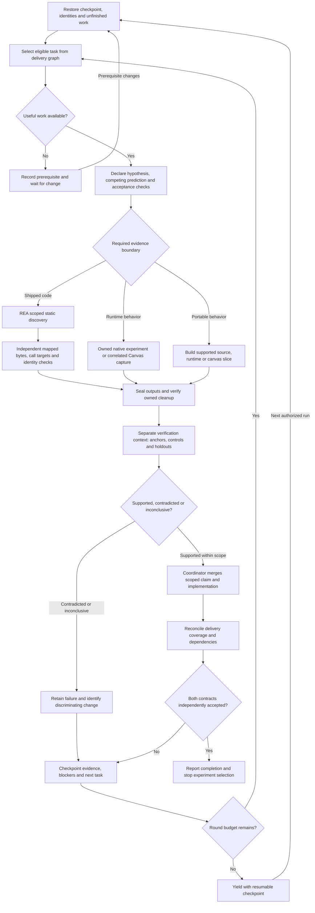

# Xcode Canvas reverse software engineering: agent loop graph

Design date: 2026-10-10. RSE means **reverse software engineering**.

Implementation: the [graph runner](graph-runner.md) now executes the bounded task
graph with persisted resume capsules, shared budgets, fresh-process mechanical
verification and independent delivery-review gates. Caveman FULL is pinned and
loaded into every wake. The evidence ontology pilot remains future work.

The outcome is an independently verified native preview contract, followed by a
working portable WASM canvas for the declared supported contract. This design
extends the existing controller and delivery graph. It does not launch a new
scheduler, authorize separate agents, or mark either milestone complete.

Graph-engineering is already installed at
`/Users/8amps/.agents/skills/graph-engineering/SKILL.md`, including its task-graph
references. The installed REA skill supplies the discovery workflow; the pinned
repository integration supplies the actual execution and evidence boundaries.

## Three graphs with different responsibilities

1. **Delivery DAG:** existing `research/roadmap/github.json` defines acceptance
   dependencies. `research/loop/workgraph.json` supplies research tasks and
   attestations. `tools/re/reloop/workgraph.py` determines eligibility and
   completion. Research can assist delivery before all delivery prerequisites pass.
2. **Execution state machine:** the diagram below repeats bounded rounds. Each
   round contains an acyclic sequence of jobs. Explicit retry edges connect rounds;
   they are not added to the delivery DAG.
3. **Evidence graph:** claims link to identified artifacts, experiments and
   verification records. Discovery, runtime observations and reconstruction
   decisions retain different types and scopes.

## Execution graph

All three discovery/build branches join at the same evidence gate. Selecting one
branch does not require executing all branches. Static discovery can propose a
later native experiment; it cannot supply that experiment's runtime observation.

## Job contracts

| Job | Inputs | Reviewable output | Gate |
| --- | --- | --- | --- |
| Restore | Git state, checkpoint, manifests, target/tool identities | Resume capsule and invalid-evidence list | Preserve user work; resume unfinished owned work before duplication |
| Select | Validated graph, blockers, cost/failure history | One task and the acceptance gap it addresses | Skip accepted research; missing anchors or unchanged blockers prevent execution |
| Predict | Gap and prior scoped evidence | Competing hypotheses, predicted outputs, negative controls, finite budget | Define success before observing results |
| REA discover | Pinned binary, question, selected profile and existing session | Evidence IDs, addresses, selected flow and unknowns | Use available schemas; retain identity/profile; no unchanged full-image import retry |
| Native observe | Reviewed owned fixture, permitted method, expected correlation | Request/reply/output trace or explicitly separate ImageRenderer oracle | Actual Canvas claims need correlated native transport; typed private runtime calls need an established safe interface |
| Portable build | Declared subset, accepted oracle/IR contract | Bounded implementation, diagnostics, reproducible artifacts | Unsupported source rejects explicitly; no implied arbitrary SwiftUI support |
| Seal | Raw outputs, exit statuses, frozen inputs, lifecycle records | Immutable manifest and retained failure artifacts | Actual peer exit and owned resource/workspace cleanup must pass |
| Verify | Sealed evidence, trusted manifest anchor, predeclared checks | Scope-limited verdict, controls, holdouts and residual unknowns | Independent checker rejects deliberately wrong outputs; no trust in worker self-report |
| Merge | Verified verdict and local patch | Updated claim index and eligible implementation | One coordinator owns writes; facts and design decisions stay distinct |
| Accept | Coverage matrix, supporting runs, dependency verdicts | Explicit delivery attestation or exact remaining gaps | Every required contract row accepted; issue state alone is insufficient |

The verification node requires a fresh review context that receives the frozen
contract and artifacts rather than the discoverer's conclusion as an answer key.
The existing controller runs independent mechanical checks serially. A separate
agent review is a future option requiring authorization under the current runbook;
this document does not dispatch agents. If that review context is unavailable,
record `review-pending` rather than asserting independently reviewed acceptance.

## Native contract and implementation path

The companion [delivery diagram](canvas-rse-delivery.mmd) is generated from all
current local roadmap dependencies. Native acceptance requires BASE, O1–O3,
R1–R3 and P1–P3. Portable acceptance requires the declared F, I, H, V, A, B, S
and D nodes. The two milestone names are delivery outcomes, distinct from the
older M0–M5 exploratory stages in `agentic-loop.md`.

The main native investigations are:

- **O1/O2/O3:** pin Xcode/OS/tool identity, recover a working observation method,
  and produce repeatable native references with positive semantic changes.
- **P1/P2:** correlate launch, request, reply, payload and output; vary one input
  at a time to recover discriminants, optionality, failures and sequencing.
- **R1/R2/R3:** measure rights/resource lifetime, identity versus generation,
  cancellation, completion, formats and applicable CPU/GPU synchronization.
- **P3:** decode and replay accepted real fixtures; reject malformed or
  unsupported envelopes and attachments without inventing missing fields.

In parallel *as research eligibility*, a portable subset may advance from an
explicitly labeled ImageRenderer oracle through F1/F2. Delivery acceptance still
follows the full DAG: F3 contracts → I1 core, I2 build adapter, I3 runtime,
I4 rendering → I5 CLI → H1 transactional reload → H2 canvas. V1 conformance
develops alongside implementation; S1, A1/A2, B1 and D1 qualify the final product.
Neither narrower portable controls nor static Apple findings close native gates.

## REA boundary and failure routing

Use the repository's pinned REA integration and Ghidra provider for scoped
discovery. Reuse a matching opened session for related queries. Record binary
SHA-256/UUID, architecture, provider/profile, tool result Evidence IDs, selected
addresses, raw result location and limitations. Independently map selected
instruction bytes and decode call targets before accepting static flow claims.
Close the owned provider and MCP connection, retaining cleanup errors.

The existing integration reports successful metadata inspection and an accepted
owned engine control. Full FoundationHost Ghidra import remains blocked after
180s and 330s timeouts. Retry requires a changed reviewed analysis profile/import
method; a smaller owned binary checks the engine, not Xcode semantics.

Current checkpoint routing, subject to identity and evidence revalidation:

| Track | Retry prerequisite | Independent useful work |
| --- | --- | --- |
| Native Canvas correlation | Changed observation/instrumentation method | Scoped static tracing or separately labeled native reference fixtures |
| Private Swift continuation | Reviewed typed interface or safe owned observation | Byte-verified static ownership analysis; no guessed private ABI |
| REA full image import | Changed reviewed import/profile | Reuse accepted evidence; focused metadata or owned engine controls |
| Browser source execution | Unlocked Mac and available approved browser prerequisite | Portable source CLI and deterministic cache work |

An unavailable runtime route stays unresolved. No indirect route bypasses an
existing approval rejection. The local checkpoint currently nominates
`primary-source-cli-cache` as useful independent work while browser access is
blocked; the selector must recompute readiness rather than hard-code this choice.

## Resume state and evidence schema

Keep existing checkpoint and acceptance fields authoritative. The companion
`canvas-rse-loop-design.json` describes routing contracts for review.
`research/loop/graph-runner.json` supplies executable task bindings and limits;
the reviewed campaign remains the experiment queue.

Each future round capsule should retain `round_id`, task/issue, git/source hashes,
target and tool identities, hypothesis and alternative, predicted observations,
owned resource IDs, budget spent/remaining, run IDs, external manifest anchors,
verdict/scope, reviewer/checker identity, failure fingerprint and changed
prerequisite. Commit stage outputs before a resumable handoff; retain actual
execution failure separately from scientific contradiction.

Use a small typed evidence graph rather than a second orchestration framework:

| Node type | Identity | Required record |
| --- | --- | --- |
| Artifact | Content digest + target UUID when present | Source path, architecture/version, provenance |
| Experiment | Run ID + frozen spec hash | Inputs, lifecycle/exit status, time and budget |
| Evidence | Run ID + artifact path + hash or REA Evidence ID | Source location/span, observation tier and coverage |
| Claim | Stable claim ID + version | Assertion, scope, confidence basis, observation/inference/decision class |
| Verification | Checker/reviewer ID + result hash | Controls, holdouts, anchor, verdict and limitations |
| Delivery | Existing roadmap issue ID | Required coverage rows and accepted dependencies |

Typed edges: Experiment `USES` Artifact; Experiment `PRODUCES` Evidence;
Evidence `SUPPORTS` or `CONTRADICTS` Claim; Verification `CHECKS` Evidence;
Verification `EVALUATES` Claim; Claim `ASSISTS` Delivery; Delivery `REQUIRES`
Delivery. Attach source, recorded-at time, scope and confidence basis to factual
nodes and edges. A reconstruction decision cannot become a native observation
through fusion. Deduplicate evidence by source digest/location/tier, keeping
conflicting claims and target versions separate. Start with ten existing sealed
runs, validate typed endpoints/provenance and manually audit precision before
expanding. Retrieve the smallest subgraph answering the selected uncertainty.

## Limits, retries and completion

- One coordinator/writer and one native controller lock; zero spawned agents
  by default. Independent read-only jobs may eventually fan out, but shared
  native sessions, Xcode windows and mutable files stay serialized.
- Proposed per-wake envelope: four rounds, four experiments total, fifteen
  minutes of controller execution and 1 GiB of artifacts total. Spend from one
  envelope across rounds; never reset it after a failure. Existing adapter
  deadlines and stricter host constraints take precedence. Reserve checkpoint
  time; the graph runner now enforces this shared envelope.
- Retry only after relevant input, implementation, environment or method changes.
  Three unchanged unsuccessful investigations block the track per the runbook.
  A blocker check can be cheap; it is not permission to repeat the costly probe.
- Clean up owned Xcode workspaces before opening another and verify zero owned
  windows; preserve unrelated projects. Preserve failed seals and quarantine
  invalid evidence.
- Human approval belongs at actions outside existing authority or expensive
  irreversible boundaries such as release publication. Routine authorized local
  research/build/checkpoint work does not need a new approval at each node.
- Milestone 1 passes only after every native delivery contract and dependency is
  accepted with sealed, anchored supporting evidence and complete scoped coverage.
  Report that transition and continue milestone 2. Completion requires every
  declared portable/platform/product contract, including failures and reload,
  independently accepted. Then report coverage and residual out-of-scope limits.
- Required unknowns, untested required platforms or missing review prevent a
  completion verdict. A blocked track or expired wake budget produces a resumable
  checkpoint, not success. This design does not change the existing automation.

## Integration order

1. Retain the existing delivery graph and evidence verifier; validate the companion
   topology against the local roadmap.
2. Add explicit round capsules and shared budgets to the existing orchestrator,
   with recovery tests for interruption, duplicate work and budget exhaustion.
3. Add the review-pending gate and contract coverage reconciliation; test wrong
   bytes, stale anchors, incomplete cleanup and unsupported scope promotion.
4. Pilot the evidence schema over ten sealed runs; retain disagreements.
5. Advance changed native capture prerequisites and the ready portable CLI/cache
   task. Run holdouts and platform acceptance before final delivery attestation.

Source contracts: [existing loop](agentic-loop.md),
[continuous runbook](continuous-loop.md), [REA integration](rea-integration.md),
[verification contract](verification.md), [remaining work](../remaining-work.md).
