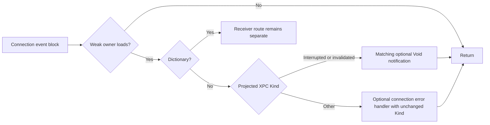

# Connection event installation and portable error routing

Restored the previous reply-dispatch seal and implementation pins with matching local/tracking branch identities. Serial work held research/state/controller.lock. Raw disassembly remained local; analysis-only LLVM wrappers were transient and removed. No private Swift ABI, native connection invocation, Xcode MCP/private bridge, protection change, signing change or user process operation occurred. The prior REA/Ghidra bounded provider check remains inconclusive; this pass used the available offline cache/LLVM route without repeating an unchanged provider failure. Both milestone contracts remain open.

## Event installation and owner lifetime gate

Pinned PreviewsServices __TEXT hash and UUID match prior evidence. Constructor helper at image-relative0x7c84 initializes the known112-byte XPCConnection layout and stores the supplied raw connection at0x10. It allocates a24-byte context and initializes Swift weak storage at context+0x10 through independently resolved swift_weakInit. It places function0x82f4 and that context in an Objective-C block whose invocation entry is0x3d00. Block_copy and XPC set_event_handler calls are independently bound to their exact exported symbols; after setting the handler on the supplied raw connection, the local block reference is released.

The block invocation entry loads function/context, retains the context and incoming XPC object across invocation, then calls the function. The0x82f4 thunk forwards its closure context to event body0x4000. That body begins access to the weak storage and calls swift_weakLoadStrong; a nil result branches directly to the epilogue before type classification or any handler. These are source ownership/control-flow edges, not a measurement of native deallocation or event delivery after cancel. The separately retained per-request captures recovered earlier remain a different route.

One Mach-service construction path calls xpc_connection_create_mach_service with second argument zero at0x8540/0x8548, then builds this connection wrapper. The pinned SDK header declares that argument as targetq and documents null as DISPATCH_TARGET_QUEUE_DEFAULT. This establishes the source creation argument and documented initial policy for that path. It does not observe an actual execution queue, establish that no later code can change it, or extend that initial policy to externally supplied connections. SDK event-handler nonconcurrency documentation is not proof of ordering between connection events and separately submitted reply callbacks. No runtime queue identity or cross-path ordering is claimed.

## Discriminating event routing

Event0x4000 compares the incoming object's XPC type with dictionary. Dictionary input branches to0x4334 and eventually the receiver handling route0x463c; that receiver protocol is deliberately outside this error adapter. Non-dictionary input invokes the existing Kind classifier at0x8004. The same metadata/producer distinguishes connectionInvalidated, invalidType, unknown, connectionInterrupted and terminationImminent. Internal tags are not numeric wire IDs.

After source logging cleanup, the error path checks Kind at0x44a8. Invalidated selects optional Void handler+0x50. Interrupted requires tag3 with zero payload bits and selects optional Void handler+0x40. All remaining cases select optional connectionErrorHandler+0x60; its call at0x44e4 receives the original Kind registers unchanged. Termination-imminent's scalar1 therefore reaches the generic error handler, whereas it emitted no connection notification on the per-request reply route.

Missing specialized handlers do not fall back to the generic handler: the invalidation nil branch goes to0x45c4 and cleanup; interruption nil goes to0x45d4 and cleanup. Missing generic handler likewise only cleans up. No request completion is invoked from this non-dictionary event route. The code does not synthesize a remote NSError reply, cancel the connection, clear all handlers, or prove target/resource completion in these branches.

## Portable implementation and checks

ServiceConnectionEvents reuses the existing notification slots and adds an independent optional connection_error callback. dispatch_error accepts an already projected XpcFailure after native type classification. It dispatches specialized Void notifications or forwards the unchanged other Kind to the generic error callback. Rust signatures/ownership are original reconstruction interfaces. A caller must separately route dictionary events to the receiver and skip dispatch when its native/model connection no longer exists; no weak reference ABI or transport queue is implemented here.

Three new integration tests cover the full category matrix with exact generic error values; absent specialized handlers without generic fallback; and explicit caller-supplied event/reply interleaving through shared notification slots. Clearing local notification slots leaves the generic error handler available. The interleaving test deliberately supplies two events itself: it does not claim observed native duplicate delivery, native exactly-once semantics, or order between the two native routes.

All193 Rust tests passed offline within60s; wasm32-wasip1 check passed within30s. The browser target wasm32-unknown-unknown remains uninstalled; this is not a browser-target compile. Source verifier replays2,240 selected native instruction bytes against LLVM, checks actual guard destinations, follows installation thunk/block edges, independently binds15 call sites, verifies Kind reflection and pins the SDK header hash. No native callback or queue observation was performed. No new failed native probe was retried.

Next recover dictionary receiver one-way/request-reply dispatch and its generated response/error path, then connect those contracts to usable reconstruction behavior. Native connection/reply queue interaction, cancellation delivery, failed-send rights and final target/resource release remain open. A static branch recovery or green build alone does not close behavioral parity.
