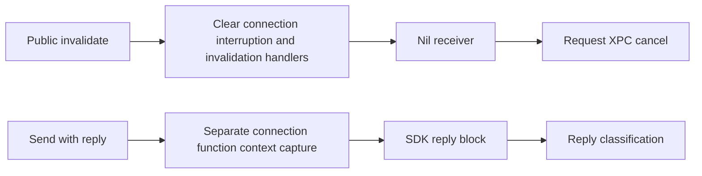

# Connection invalidation path and separate per-reply captures

Restored and verified the sealed service wire-reply checkpoint, all implementation pins and equal local/remote branch identities. Serial work held research/state/controller.lock. The cached Services image matches the same pinned __TEXT/UUID. Prior provider health remains inconclusive; no unchanged REA/Ghidra import/restart failure was retried. No Xcode MCP/private bridge, user Xcode/simulator process, protection change, re-signing or native connection was used. Both milestones remain open.

## Concrete runtime dispatch limitation

Owned inspect.m loads the system framework in its own process, then uses public Objective-C runtime queries only. XPCConnection and PreviewsServiceConnection exist but declare zero Objective-C instance/class methods. The nested listener wrapper exposes only init and .cxx_destruct; no callable connection/callback configuration was found there. No instance was allocated, no guessed initializer/Swift ABI was invoked, and no swizzling occurred. Empty ivar type encodings are retained as unknown; field names/offsets do not supply a callable Swift prototype. The SDK documents class_copyMethodList as declared methods only; inherited basic methods were not audited. This table does not supply the recovered service Swift entry points for NSInvocation and does not prove that every alternative entry point is absent. Compiler-backed and static analysis routes remain separate.

A second discriminating query adds field layouts through class_copyIvarList, ivar_getOffset and class_getInstanceSize. Four sanitized layouts are published; full initial inspection remains local. The Connection object is112 bytes with connection16, messageReceiver24, interruptionHandler64, invalidationHandler80 and connectionErrorHandler96. The Listener object is128 bytes, with listenerService16/service24 and four callback pairs at64,80,96,112. Public wrapper Connection is32 bytes with inner connection16/auditToken24. These are measured layouts for this pinned runtime, not portable allocation/ABI declarations. Build30s and execution5s bounds completed normally.

## Correct explicit invalidation path

Exact export metadata binds public PreviewsServiceConnection.invalidate at0x26330a12c. Its wrapper loads the inner connection and calls0x2633037c4. That complete body directly zeroes the interruption closure pair0x40 and invalidation pair0x50, releases their prior contexts via the optional-closure release helper, then assigns a nil40-byte receiver existential at0x18. The callback at0x60 is not directly cleared by that body. This is a static store/call footprint, not an atomic runtime postcondition: custom destruction/reentrancy and event ordering remain unobserved.

The operation helper receives a pointer from slot0x28f680980. A checked regular-v5 chain resolves it to exact libxpc export xpc_connection_cancel. The adjacent operation slot resolves activate. Source signs those loaded operation pointers before indirect dispatch; analysis performs no PAC signing or invocation. The generic helper loads the backing raw connection from object+0x10 and calls the selected operation. Explicit invalidation return therefore cannot be promoted to callback/target/resource settlement on this source alone.

A nearby broader cleanup routine0x263303a70 was deliberately distinguished. It writes callback pairs through0x70, which is outside the measured112-byte Connection object and matches the Listener's128-byte layout. Its owner is a layout-compatible listener-path inference; it is not the public connection-invalidate routine and must not substitute for that path in reconstruction. Independent Swift field descriptors confirm the two classes' distinct named fields. This distinction prevents an incorrect all-handler-clear interpretation.

## Reply ownership is structurally separate

Send-with-reply allocates an independent40-byte Swift capture. Native stores place connection, reply function and reply context at capture offsets16,24,32; strong-retain edges and Block_copy are independently bound. The callback thunk0x263308e28 loads those three fields and branches to the previously recovered reply handler. Explicit invalidation's stores address the connection object/receiver/connection-level handlers, not this per-request allocation.

The graph captures source structure only. It does not prove that a pending callback survives/delivers after this exact cancel, which event wins, how many callbacks occur, or when all captured objects/rights/resources are released. Earlier actual BoardServices invalidation/late-reply controls are a separate route and are not relabeled PreviewsServices evidence. No speculative Rust cancellation/lifetime controller was added from these incomplete runtime semantics.

Verifier pins image/export identities, follows the exact invalidate call, validates direct clear/nil-assignment instructions and helper edges, resolves activate/cancel operations and six capture/block ownership imports, reads both Swift field descriptors, checks saved runtime layouts, and compares1792 selected native instruction bytes against LLVM. It keeps raw code/disassembly/wrappers local. Three bounded static exploration failures are summarized: the strict authenticated-code reader correctly rejected a regular pointer, and two supplied non-branch addresses triggered branch-decoder assertions. Corrections use the regular-pointer reader and opcode-verified call sites. No failure launched a native connection or changed product code.

Product implementation pins remain unchanged. The prior186 Rust tests and wasm32-wasip1 check are historical verified results, not rerun claims. The new original runtime observer was compiled/run and the source/layout verifier was replayed. Graph inspection had no unfinished owned execution; the stale completed portable task was skipped. Both milestone acceptance flags remain false.

Next recover event-handler installation/queue and callback ordering for this exact connection, or another genuinely unmeasured permitted resource boundary. Compiler-backed typed interfaces would be required for private Swift dispatch; method/field metadata alone is insufficient. Actual native callback ordering, failed-send rights, shared surfaces and target/resource completion remain open. No user action is essential while useful static/runtime-layout analysis routes remain.
