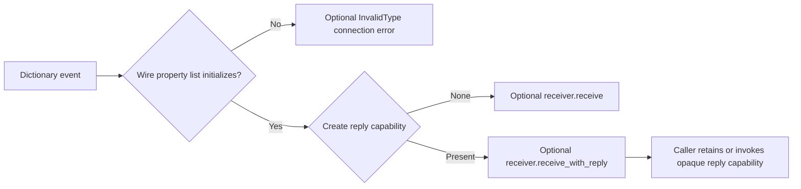

# Dictionary receiver routing and owned XPC reply capability

Restored the sealed connection-event checkpoint and implementation pins; local/tracking development/master identities matched. Serial work held research/state/controller.lock. Raw Apple code stayed local; the source verifier uses transient analysis-only wrappers and removes them. No Xcode MCP/private bridge, guessed Swift ABI, native private receiver invocation, user Xcode/simulator operation, protection change or re-signing occurred. Prior provider health remains inconclusive; unchanged REA/Ghidra failure attempts were not repeated. Both milestones remain open.

## Source receiver contract

Pinned PreviewsServices image hash/UUID matches earlier findings. Dictionary event handling at image-relative0x463c first calls UVPropertyList.initWithXpcDictionary at0x4710. A nil initializer branches at0x4714 to the optional connection-error handler, with invalidType of the raw XPC description. If that handler is absent, it returns; the reply-capability helper and receiver methods are not called in this branch.

Successful initialization proceeds to independently resolved xpc_dictionary_create_reply at0x4720 before checking receiver presence. A nonnil reply dictionary selects the request/reply route; nil selects one-way. Neither path asks for the property's decoded dictionary here. Thus nonempty malformed plist bytes, non-dictionary plist roots and NSError-shaped message dictionaries can remain lazy message input rather than being classified as remote reply errors.

The connection receiver existential lives at0x18; its type-presence slot0x30 is checked independently in each path. A missing receiver performs cleanup without a generated response or fallback connection notification. A present receiver is copied/projected for method dispatch. The one-way witness slot is+0x8, matching the exact public protocol dispatcher export at0xad34; request/reply uses+0x10, matching export0xad48. The actual calls at0x4bd0/0x4b08 have matching witness offsets and pointer-authentication call shapes. Reflection/export evidence is not used as an executable private Swift ABI declaration.

The request/reply branch creates a24-byte weak connection context and32-byte callback capture containing that weak context and the reply dictionary. It supplies thunk0x8420 to the receiver. The thunk forwards capture fields to response body0x6048. That body's complete nullable/error conversion and serialization policy is still a separate unfinished contract. This pass does not guess NSError conversion, synthesize empty responses or claim callback execution after connection destruction.

## Native owned control

Original native.c creates only its own anonymous XPC listener, endpoint/client and accepted peer. It sends the existing owned301-byte nested property-list fixture twice. Native one-way receipt returns nil from xpc_dictionary_create_reply; native send-with-reply receipt returns a reply dictionary, and its client callback receives the owned accepted flag. Both deliveries preserve all301 data bytes. An ordinary locally constructed dictionary carrying those same data bytes has no reply capability. Zero errors were observed before cleanup and the bounded group completed normally.

This is actual public-XPC capability behavior, correlated with the recovered private source call. It is not execution of PreviewsServices' receiver, callback ABI, target queue or response serialization. Build30s, execution5s and internal wait3s bounds apply. Cleanup cancels only the owned connections. Helper process exit/cancel return does not establish that kernel rights or other target resources settled. The control never launches or terminates Xcode/simulator processes.

The initial C probe failed to compile because blocks cannot capture array declarations directly; it never executed. The corrected control captures a pointer whose stack storage remains alive through the group wait and synchronized result read. Final status is computed on the callback queue before cancellation, avoiding a cleanup-event read race. The original Rust deferred-callback test also failed to compile from an inferred i32 versus declared u32; it was corrected and the full suite rerun. Both failed build logs and a scoped failure ledger are retained. An initial unanchored text query produced truncated output; corrected numeric-address extraction and byte verification establish the final source coverage.

## Portable reconstruction

prepare_service_dictionary composes the measured ServicePropertyList wire initializer with a caller-supplied reply-capability creator. It rejects absent/wrong/empty data before invoking that creator. It returns either OneWay or WithReply carrying the original lazy bytes and opaque capability R. None means rejected initializer only; the caller can report InvalidType through its optional connection error handler, matching the outer source path without inventing a default response.

ServiceMessageReceiver provides original Rust receive/receive_with_reply methods. Prepared messages dispatch to the matching method; an absent receiver drops local values. Opaque R permits the caller to retain a callback/channel for deferred response. The tests' FnOnce capability is an explicit Rust caller choice, not native exactly-once evidence. Rust drops are local ownership observations, not native reply-right destruction guarantees. No response is automatically sent and no native queue, weak ABI or resource lifecycle is implemented by this adapter.

Four integration tests cover capability selection across native owned-input nested/malformed/array/error fixtures, rejection before capability creation, missing receiver capture disposal, and a receiver retaining a reply callback for later use. All197 Rust tests pass offline within60s, and wasm32-wasip1 check passes within30s. Browser-target compilation is not claimed. Source verifier independently compares1,724 selected native instruction bytes to LLVM, binds seven call sites, resolves the initializer selector, matches both protocol exports and checks rejection/capability/receiver guards. Raw native binaries/disassembly remain local; published source is the original reconstruction/control/verifier only.

Next recover the response body0x6048 nullable outcome selection and NSError conversion/encoding branches, then integrate an original response path with these receiver capabilities. Native target cancellation, cross-path queue order, failed-send rights, shared resource completion and both milestone acceptance contracts remain unresolved.
