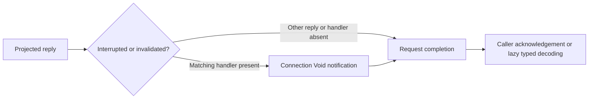

# Reply connection notifications before request completion

This source-guided implementation extends the portable callback path with optional interruption and invalidation notifications. Serial work held research/state/controller.lock. The prior invalidation/capture checkpoint seal and implementation pins were restored; local and tracking development/master identities matched before edits. Existing staged and working changes were preserved. Raw code remained local. No native connection or callback was invoked, no guessed Swift ABI was declared, and no Xcode MCP/private bridge was used. REA/Ghidra provider state remains inconclusive from the previous bounded attempt; this pass used the available offline cache and LLVM route without repeating unchanged provider failures. Both milestone contracts remain open.

## Source observations

Pinned system PreviewsServices __TEXT hash and image UUID match the previous source/runtime layout checkpoint. The verifier checks the XPCError.Kind metadata and the actual classifier's tag construction, then follows guards in the send-with-reply callback. At image-relative0x5758 the Kind tag is tested; tag0 routes to the invalidation closure slot at connection+0x50. Tag3 additionally requires both payload registers to be zero before loading interruption slot+0x40. Termination-imminent uses the same payloadless tag with scalar1 and therefore bypasses that notification. These are internal pinned enum representation details, not numeric wire IDs.

The interruption closure is optional: its nil guard branches to0x5968, while an existing closure is invoked at0x5788 and reaches the same completion path after context release. Invalidation likewise checks its optional closure at0x591c/0x5920 and invokes it at0x5948. Both notifications have Void signatures in the recovered named field metadata; neither receives the per-request error. The shared completion constructs an error retaining the original Kind payload/tag, passes nil as the reply payload and invokes the separately captured request closure at0x59a0. Notification therefore precedes request completion on these source paths. A nil notification slot bypasses only the notification.

The decoded NSError dictionary path and success path have distinct callback branches. Invalid type, unknown, termination-imminent, decoded remote NSError, and successful payloads do not invoke these two notifications on this reply route. The generic connection event handler remains a separate unrecovered route; no connectionErrorHandler behavior is supplied by this adapter. This is static control-flow evidence, not a native timing/concurrency observation.

Source verifier independently compares2,980 selected native instruction bytes against LLVM (complete0x53e0..0x5ddc reply body plus0x8004..0x81ac Kind classifier), checks guard/callback opcodes and conditional destinations, and rereads Kind reflection. Analysis-only wrappers and native disassembly are transient private files that are cleaned up; no Apple bytes or raw disassembly are published. Prior measured112-byte connection layout and handler offsets are linked through predecessor.json rather than relabeled as a new runtime probe.

## Original portable implementation

ServiceReplyNotifications stores two optional caller-owned Rust handlers. Its dispatch method receives the existing selected Result, invokes the matching connection notification synchronously when present, then forwards that exact Result to the request completion. Returning the completion's value allows callers to compose existing acknowledgement or typed decoding. EmptyReply is an original portable diagnostic, forwarded without notification. No new native ABI or wire encoding is introduced.

clear_connection_notifications drops interruption and invalidation captures in that order. Its deliberately scoped name distinguishes this local slot operation from native invalidate: it does not nil a receiver, call XPC cancel, clear a connection-error handler, consume a pending request, or assert resource settlement. Rust capture ownership is independently tested; these tests do not prove native lifetime or delivery after cancellation. Panic/reentrant destruction, queue selection, races, exact native callback multiplicity, and cancellation delivery remain outside this synchronous profile.

Four new integration tests cover the full category matrix and order before completion, absent/cleared notifications, separate local request-capture destruction, and the existing actual-native owned-input wire fixtures. The malformed serialized fixture remains selected success and still fails when parsed later; the native remote-error fixture remains a remote NSError projection. Neither emits a connection notification. All190 Rust tests passed offline under60s and wasm32-wasip1 check passed under30s. wasm32-unknown-unknown is not installed; this result is not a browser-target compile or complete Canvas parity claim.

Next recover generic connection event-handler installation/queue and reconcile its callbacks with this per-reply route, or advance another missing protocol/resource contract. Exact PreviewsServices native cancellation ordering, resource completion, failed-send rights and Canvas runtime integration remain unresolved. Helper completion, successful compilation, and these source-derived dispatch tests do not close either milestone.
